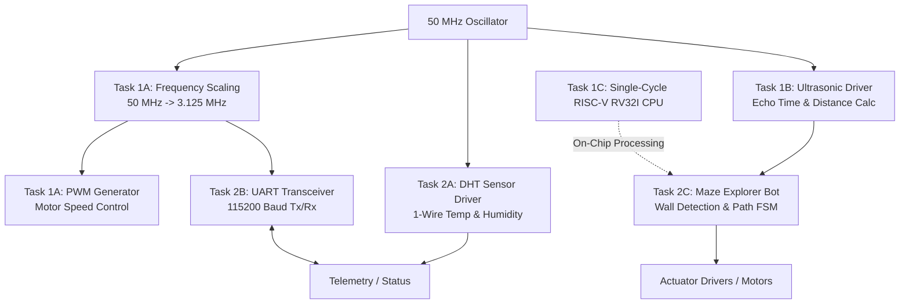

# 🤖 e-Yantra Robotics Competition: MazeSolver Bot (Theme: MazeBot)

[](https://www.intel.com)
[](https://en.wikipedia.org/wiki/Verilog)
[](https://www.intel.com/content/www/us/en/software-kit/665990/intel-quartus-prime-lite-edition-design-software-version-20-1-for-linux.html)
[](https://www.intel.com)
[](https://www.e-yantra.org)

This repository contains the complete hardware design, RTL implementations, testbenches, and system architecture developed for the **e-Yantra Robotics Competition (eYRC) - MazeBot (MazeSolver)** theme by **Team 2603**.

The project encompasses the end-to-end FPGA design of an autonomous maze-solving mobile robot: from custom clock scaling and PWM motor control, digital sensor interfaces (Ultrasonic & DHT), and serial UART communication, to a 32-bit single-cycle RISC-V RV32I processor core and a real-time hardware maze exploration algorithm.

---

## 📑 Table of Contents

- [System Architecture](#-system-architecture)
- [Repository Structure](#-repository-structure)
- [Detailed Task Descriptions](#-detailed-task-descriptions)
  - [Task 1A: Frequency Scaling & PWM Generator](#task-1a-frequency-scaling--pwm-generator)
  - [Task 1B: HC-SR04 Ultrasonic Distance Sensor Driver](#task-1b-hc-sr04-ultrasonic-distance-sensor-driver)
  - [Task 1C: Single-Cycle 32-Bit RISC-V (RV32I) CPU](#task-1c-single-cycle-32-bit-risc-v-rv32i-cpu)
  - [Task 2A: DHT Digital Temperature & Humidity Sensor Interface](#task-2a-dht-digital-temperature--humidity-sensor-interface)
  - [Task 2B: UART Hardware Transceiver (Tx & Rx)](#task-2b-uart-hardware-transceiver-tx--rx)
  - [Task 2C: Autonomous Maze Explorer & Solver Bot](#task-2c-autonomous-maze-explorer--solver-bot)
- [Hardware & Software Prerequisites](#-hardware--software-prerequisites)
- [Simulation & Compilation Guide](#-simulation--compilation-guide)
- [Authors & Acknowledgments](#-authors--acknowledgments)

---

## 🏛 System Architecture

The robot hardware stack operates on an **Intel/Altera Cyclone IV FPGA** (50 MHz onboard oscillator) and is partitioned into modular RTL subsystems:



---

## 📂 Repository Structure

```
.
├── README.md                      # Comprehensive project documentation
├── .gitignore                     # Git ignore rules for Quartus/ModelSim artifacts
│
├── Task-1A_FS_PWM/                # Frequency scaling and variable-duty PWM controller
│   ├── code/
│   │   ├── frequency_scaling.v    # 50 MHz to 3.125 MHz clock divider
│   │   ├── pwm_generator.v        # PWM signal & 195.3125 kHz clock generator
│   │   ├── t1a_fs_pwm.bdf         # Top-level Block Design File
│   │   └── t1a_fs_pwm_bdf.v       # Netlist of top-level integration
│   ├── simulation/modelsim/       # ModelSim simulation scripts & waveforms
│   ├── .test/tb.v                 # Automated testbench for verification
│   └── t1a_fs_pwm.qpf / .qsf      # Quartus project and pin constraint files
│
├── Task-1B_Ultrasonic/            # HC-SR04 ultrasonic rangefinder interface
│   ├── code/
│   │   └── t1b_ultrasonic.v       # Trigger generator, echo counter, and distance calculator
│   ├── .test/tb.v                 # Testbench simulating echo pulse responses
│   └── t1b_ultrasonic.qpf / .qsf  # Quartus project and constraint configuration
│
├── Task-1C_RISCV_CPU/             # Custom 32-bit single-cycle RISC-V RV32I CPU
│   ├── code/
│   │   ├── t1c_riscv_cpu.v        # Top-level wrapper module with memory integration
│   │   ├── riscv_cpu.v            # Top-level CPU core (Datapath + Controller)
│   │   ├── instr_mem.v            # Instruction memory module
│   │   ├── data_mem.v             # Data memory module
│   │   ├── rv32i_test.s           # RISC-V assembly test suite
│   │   ├── rv32i_test.hex         # Machine code hex file for simulation
│   │   └── components/            # Datapath and control unit building blocks
│   │       ├── alu.v              # 32-bit Arithmetic Logic Unit
│   │       ├── alu_decoder.v      # ALU operation decoder (funct3, funct7, ALUOp)
│   │       ├── controller.v       # Top-level instruction control unit
│   │       ├── datapath.v         # Datapath interconnect
│   │       ├── imm_extend.v       # Immediate sign-extension unit (I, S, B, U, J)
│   │       ├── main_decoder.v     # Opcode main decoder
│   │       ├── reg_file.v         # 32 x 32-bit dual-read single-write register file
│   │       ├── adder.v            # 32-bit Ripple / Carry Adder
│   │       ├── mux2.v, mux3.v...  # Parametric multiplexers
│   │       └── reset_ff.v         # Synchronous/asynchronous reset flip-flops
│   ├── simulation/modelsim/       # ModelSim test benches and hex files
│   └── .test/tb.v                 # Testbench verifying instruction execution
│
├── Task-2A_DHT/                   # DHT11/DHT22 digital temperature & humidity sensor
│   ├── code/
│   │   └── t2a_dht.v              # Bi-directional 1-wire FSM controller
│   ├── .test/tb.v                 # Testbench simulating DHT 40-bit transmission
│   └── t2a_dht.qpf / .qsf         # Quartus project configuration
│
├── Task-2B_UART/                  # Full-duplex hardware UART communication
│   ├── uart_tx/                   # UART Transmitter subsystem
│   │   ├── code/uart_tx.v         # Serializer, start/stop bit, parity generator
│   │   ├── .test/tb.v             # Transmitter verification testbench
│   │   └── uart_tx.qpf / .qsf     # Quartus project files
│   └── uart_rx/                   # UART Receiver subsystem
│       ├── code/uart_rx.v         # Deserializer, oversampling, parity checker
│       ├── .test/tb.v             # Receiver verification testbench
│       └── uart_rx.qpf / .qsf     # Quartus project files
│
└── Task-2C_Maze_Explorer/         # Real-time FPGA maze exploration and solving
    ├── code/
    │   └── t2c_maze_explorer.v    # Navigation FSM, wall avoidance, visit logging
    ├── .test/tb.v                 # Full 9x9 maze grid simulation testbench
    └── t2c_maze_explorer.qpf/.qsf # Quartus project configuration
```

---

## 🔍 Detailed Task Descriptions

### Task 1A: Frequency Scaling & PWM Generator
- **Location:** [`Task-1A_FS_PWM/`](file:///Task-1A_FS_PWM)
- **Objective:** Generate a down-scaled master clock and a variable duty-cycle PWM waveform to regulate DC motor velocities.
- **Key Modules:**
  1. `frequency_scaling.v`: Implements a 3-bit counter to divide the onboard 50 MHz FPGA clock by 16, yielding a **3.125 MHz** intermediate clock ($50\,\text{MHz} / 16 = 3.125\,\text{MHz}$).
  2. `pwm_generator.v`:
     - Further divides the 3.125 MHz clock to produce a **195.3125 kHz** reference clock ($3.125\,\text{MHz} / 16 = 195.3125\,\text{kHz}$).
     - Takes a 4-bit `duty_cycle` input (`0` to `15`) and generates a pulse-width modulated signal `pwm_signal` using a 4-bit synchronous accumulator (`pwm_counter`).
  3. `t1a_fs_pwm.bdf` & `t1a_fs_pwm_bdf.v`: Schematic and netlist linking the frequency scaler to the PWM generator.

| Port | Direction | Bit Width | Description |
| :--- | :--- | :---: | :--- |
| `clk_50M` | Input | 1 | 50 MHz master oscillator input |
| `duty_cycle` | Input | 4 | PWM duty ratio setting ($0/16$ to $15/16$) |
| `clk_3125KHz`| Output | 1 | Scaled 3.125 MHz clock |
| `clk_195KHz` | Output | 1 | Scaled 195.3125 kHz reference clock |
| `pwm_signal` | Output | 1 | High-frequency motor drive PWM output |

---

### Task 1B: HC-SR04 Ultrasonic Distance Sensor Driver
- **Location:** [`Task-1B_Ultrasonic/`](file:///Task-1B_Ultrasonic)
- **Objective:** Interface with the HC-SR04 ultrasonic transducer to detect walls and measure front obstacle clearance in millimeters.
- **Working Principle:**
  1. **Trigger Generation:** Asserts `trig` HIGH for $10\,\mu\text{s}$ (500 clock ticks of 50 MHz clock).
  2. **Echo Measurement:** Upon receiving `echo_rx` HIGH, counts clock pulses using a high-resolution counter until `echo_rx` drops LOW.
  3. **Distance Calculation:** Computes distance according to sound velocity ($340\,\text{m/s}$):
     $$\text{Distance (mm)} = \frac{\text{echo\_counter} \times 34}{10000}$$
  4. **Obstacle Determination:** If measured distance $\le 70\,\text{mm}$, flags `detection = 1`.
- **FSM States:** `DELAY` $\rightarrow$ `TRIG_PHASE` $\rightarrow$ `MONITOR` $\rightarrow$ `OBJECT_DETERMINATION` $\rightarrow$ `FINISHED`.

---

### Task 1C: Single-Cycle 32-Bit RISC-V (RV32I) CPU
- **Location:** [`Task-1C_RISCV_CPU/`](file:///Task-1C_RISCV_CPU)
- **Objective:** Design and synthesize a 32-bit single-cycle processor compliant with the RISC-V RV32I Base Integer Instruction Set Architecture.
- **Architectural Features:**
  - **Single-Cycle Datapath:** Completes instruction fetch, decode, execute, memory access, and write-back within a single clock cycle.
  - **Register File:** 32 general-purpose 32-bit registers (`x0` hardwired to `0`), supporting two asynchronous read ports and one synchronous write port.
  - **ALU Operations:** ADD, SUB, AND, OR, XOR, SLT, SLTU, SLL, SRL, SRA.
  - **Branch & Jump Handling:** Implements conditional branches (`BEQ`, `BNE`, `BLT`, `BGE`, `BLTU`, `BGEU`) and unconditional jumps (`JAL`, `JALR`).
  - **Memory System:** Separate 32-bit Instruction Memory (`instr_mem.v`) and Data Memory (`data_mem.v`).
  - **Test Program:** Verified through assembly test suites (`rv32i_test.s`) verifying ALU arithmetic, memory operations, and branch hazard resolution.


---

### Task 2A: DHT Digital Temperature & Humidity Sensor Interface
- **Location:** [`Task-2A_DHT/`](file:///Task-2A_DHT)
- **Objective:** Implement a reliable bi-directional 1-wire protocol controller for digital temperature and relative humidity telemetry.
- **Protocol & FSM Implementation:**
  - **Tri-State Bus Control:** Uses bidirectional pin `sensor` via `assign sensor = (io_ctrl_dir) ? io_output_sig : 1'bz`.
  - **Start Signal:** Drives the data bus LOW for $> 18\,\text{ms}$ (`THR_LOW_START = 899990` ticks at 50 MHz), then pulls HIGH for $40\,\mu\text{s}$.
  - **Handshake Response:** Verifies the sensor's $80\,\mu\text{s}$ LOW and $80\,\mu\text{s}$ HIGH acknowledgement pulses.
  - **Bit Decoding:** Discriminates logic `'0'` ($26\text{--}28\,\mu\text{s}$ HIGH pulse) from logic `'1'` ($70\,\mu\text{s}$ HIGH pulse) across all 40 bits.
  - **Checksum Verification:**
    $$\text{Checksum} = \text{RH\_integral} + \text{RH\_decimal} + \text{T\_integral} + \text{T\_decimal}$$
    Asserts `data_valid = 1` only when the received checksum matches the calculated sum.

---

### Task 2B: UART Hardware Transceiver (Tx & Rx)
- **Location:** [`Task-2B_UART/`](file:///Task-2B_UART)
- **Objective:** Establish reliable asynchronous serial telemetry at **115200 baud** using a 3.125 MHz system clock.
- **Transmitter (`uart_tx`):**
  - Bit period: $27$ clock cycles at 3.125 MHz ($3.125\,\text{MHz} / 27 \approx 115740\,\text{bps}$).
  - Frame layout: 1 Start Bit (`0`) + 8 Data Bits (LSB first) + 1 Parity Bit (configurable Even/Odd) + 1 Stop Bit (`1`).
  - FSM States: `IDLE_STATE` $\rightarrow$ `START_STATE` $\rightarrow$ `DATA_STATE` $\rightarrow$ `PARITY_STATE` $\rightarrow$ `STOP_STATE`.
- **Receiver (`uart_rx`):**
  - Mid-bit oversampling for noise rejection and accurate bit capture.
  - Validates start bit, extracts 8-bit payload, checks parity bit, confirms stop bit, and asserts `rx_complete = 1`.

---

### Task 2C: Autonomous Maze Explorer & Solver Bot
- **Location:** [`Task-2C_Maze_Explorer/`](file:///Task-2C_Maze_Explorer)
- **Objective:** Autonomous real-time path planning and navigation algorithm in FPGA hardware to explore and solve a 9x9 grid maze.
- **Specifications:**
  - **Grid Size:** $9 \times 9$ matrix (81 cells total, indices 0 to 80).
  - **Start Position:** Cell `(4, 0)` (index 76).
  - **Exit Goal:** Cell `(4, 8)`.
  - **Sensor Inputs:** 3-direction wall detectors (`left`, `mid`, `right`): `0 = open`, `1 = wall`.
  - **Motion Commands (`move[2:0]`):**
    - `3'b000` (0): **STOP**
    - `3'b001` (1): **FORWARD**
    - `3'b010` (2): **LEFT TURN**
    - `3'b011` (3): **RIGHT TURN**
    - `3'b100` (4): **U-TURN**
- **Navigation Intelligence:**
  - Maintains current orientation state: `DIR_NORTH`, `DIR_SOUTH`, `DIR_EAST`, `DIR_WEST`.
  - Uses an on-chip visit matrix `visit_log[0:80]` tracking visit counts per cell.
  - When encountering junctions, prioritizes unvisited paths (`visit_log == 0`) over previously explored passages.
  - Automatically identifies dead-ends (when `left`, `mid`, and `right` are all blocked) and performs a U-turn to backtrack.

---

## 🛠 Hardware & Software Prerequisites

1. **Hardware:**
   - Intel/Altera Cyclone IV E FPGA Board (e.g., DE0-Nano / EP4CE22F17C6N).
   - Ultrasonic Sensor HC-SR04.
   - DHT11 / DHT22 Sensor.
   - USB-to-UART Bridge (FT232R / CP2102) for serial communication.
   - Dual DC Geared Motors with H-Bridge Motor Driver (L298N / L293D / TB6612FNG).
2. **Software:**
   - **Intel Quartus Prime Lite Edition v20.1** (or compatible version).
   - **ModelSim-Intel FPGA Edition** for behavioral and gate-level RTL simulation.

---

## 🚀 Simulation & Compilation Guide

### 1. Opening a Project in Quartus Prime
To synthesize and generate the FPGA bitstream (`.sof`) for any task:
```bash
# Example: Open Task 2C Maze Explorer in Quartus Prime
quartus Task-2C_Maze_Explorer/t2c_maze_explorer.qpf &
```
1. Click **Processing $\rightarrow$ Start Compilation** (or press `Ctrl + L`).
2. Verify that timing analysis meets constraints.
3. Open **Tools $\rightarrow$ Programmer** and flash the `.sof` file onto the Cyclone IV FPGA via USB-Blaster.

### 2. Running Testbenches in ModelSim
Each task includes an automated testbench located in its `.test/` or `simulation/` directory:
```bash
# Example: Compile and run testbench using vsim / ModelSim CLI
cd Task-1C_RISCV_CPU/
vlib work
vlog code/components/*.v code/*.v .test/tb.v
vsim -c -do "run -all; quit" tb
```

---

## 👥 Authors & Acknowledgments

- **Team ID:** 2603
- **Competition:** [e-Yantra Robotics Competition (eYRC)](https://www.e-yantra.org)
- **Organized By:** IIT Bombay & Ministry of Education, Government of India.
